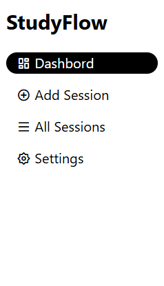
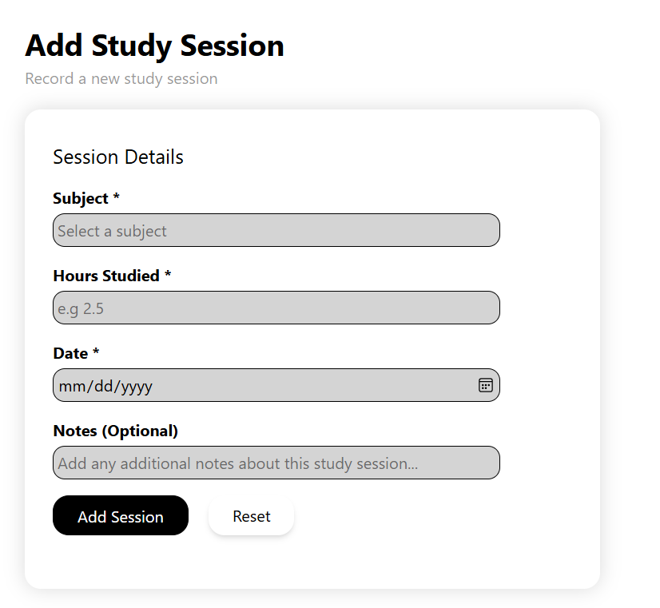
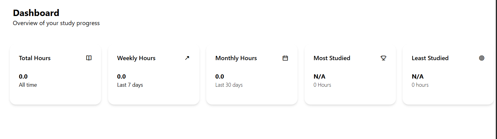
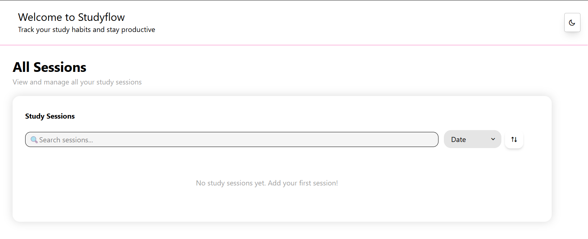
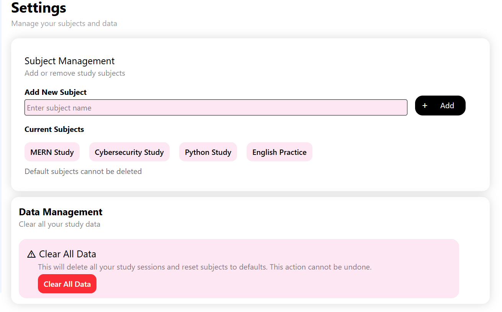

# **StudyFlow**

## What kind of project is this?
    StudyFlow is a React-based web application designed for students to track and manage their study sessions. It allows students to add new sessions, view all past sessions, and delete sessions to maintain a record of what they have learned.

## Features

- **Add Study Sessions:** Record the subject, hours studied, date, and optional notes.

- **Dashboard Overview:** View total, weekly, and monthly study hours, as well as most and least studied subjects.

- **All Sessions:** Browse and manage all recorded study sessions, with search and sorting options.

- **Settings:** Manage subjects by adding or removing them, and clear all data if needed.

- **Responsive Design:** User-friendly interface with Tailwind CSS styling.

## Technologies Used

- **Frontend:** React.js
- **Styling:** Tailwind CSS
- **Icons:** Remix Icon library

**State Management:** Each component keeps track of its own data without using extra libraries.

- **File Structure:** Modular components (`Dashboard`, `Add`, `AllSessions`, `Settings`, `Welcome`, `Study`)

# Folder path 

TaskFlow_Project/
├── src/
│   └── component/
│       ├── Add_Sessions
            └──add.jsx
│       ├── All_Session
            └──All_Sessions.jsx
        ├──Settings
            └──Setting.jsx
        ├──Content.jsx
        ├──Rightcontent.jsx
        ├──Dashboard_Folder
            └──Dashboard.jsx
            └──Study.jsx
            └──Welcome.jsx
│       
│       
│       
│      
│       
│       
├── App.jsx
├── main.jsx